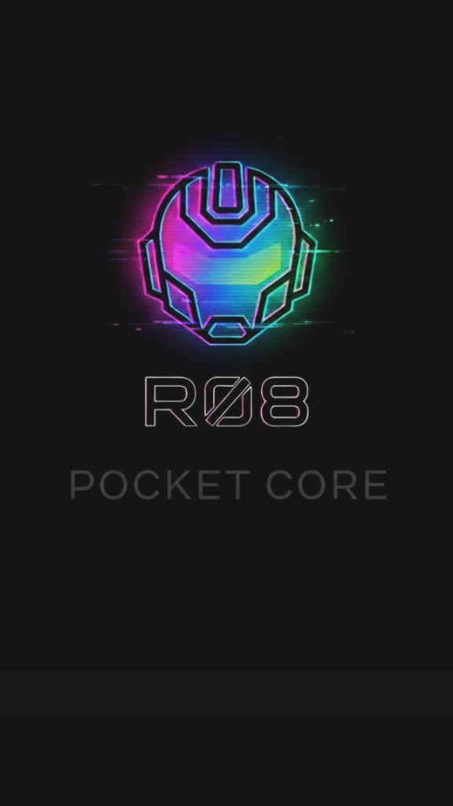
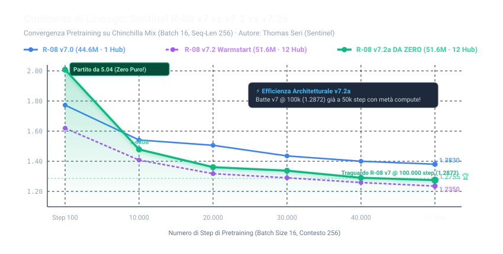
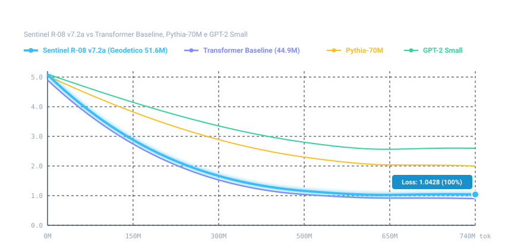
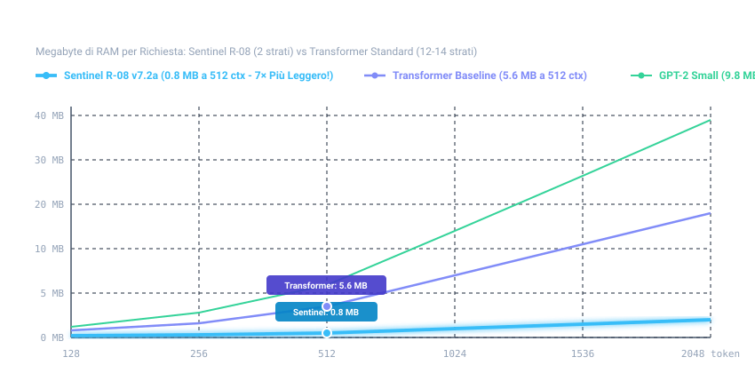

<p align="center">
  
</p>

# 🌐 Sentinel R-08 v7.2a (DA ZERO) — 51.6M Geodesic Language Model

[](https://www.sentinelhub.eu)
[](https://www.sentinelhub.eu)
[](https://github.com/Thomasseri/gpTommy-32k)
[-orange.svg)](https://www.sentinelhub.eu)

> **Architettura Geodetica a 3 Sfere Concentriche, 12 Hub Regionali dell'Icosaedro e Convoluzioni Causali 1D.**  
> **Autore & Ideatore:** Thomas Seri (Sentinel)  
> **Ecosistema di Riferimento:** [Sentinel LifeOS](https://www.sentinelhub.eu)  
> **Vocabolario Ufficiale Correlato:** [gpTommy 32k su GitHub](https://github.com/Thomasseri/gpTommy-32k) | [Hugging Face](https://huggingface.co/SentinelHub/gpTommy-32k)  
> **Stato di Rilascio:** 🚀 **Rilascio Ufficiale per Inferenza & Utilizzo** (Pesi `model.safetensors` e runtime di inferenza inclusi; script per replicare l'addestramento trattenuti).

---

> [!IMPORTANT]
> ### ⚡ NOTA DI RILASCIO: UTILIZZO IN INFERENZA ABILITATO (PIPELINE DI TRAINING PROPRIETARIA)
> Questa repository contiene tutto il necessario per **caricare e utilizzare subito in inferenza** il modello **Sentinel R-08 v7.2a DA ZERO** (51.614.115 parametri), inclusi il runtime geodetico e i pesi ufficiali `model.safetensors` (su Hugging Face e nelle Release GitHub).  
> **I file sorgente per replicare da zero l'addestramento, gli ottimizzatori e le pipeline di creazione del dataset non sono inclusi pubblicamente** e restano riservati al laboratorio dell'autore.

---

## 💻 Come Usare subito Sentinel R-08 v7.2a (Inferenza Rapida)

### 1. Requisiti
```bash
pip install torch safetensors huggingface_hub
```

### 2. Test Immediato con lo Script Incluso
Se hai clonato il repository da Hugging Face (`git clone https://huggingface.co/SentinelHub/R-08-v7.2a`) o scaricato `model.safetensors` dalla sezione **Releases** di GitHub nella cartella del progetto:
```bash
python test_inference_release.py
```

### 3. Utilizzo da Codice Python
```python
from modeling_geodesic import R08Model, R08Tokenizer

tokenizer = R08Tokenizer.from_pretrained(".")
model = R08Model.from_pretrained(".")

risposta = model.generate(
    prompt="La capitale d'Italia è",
    tokenizer=tokenizer,
    max_new_tokens=32,
    temperature=0.7,
    top_p=0.9,
    repetition_penalty=1.15,
)
print(risposta)
```

---

## 🏆 I Nuovi Record di Laboratorio di Sentinel R-08 v7.2a

Addestrato **100% DA ZERO (Tabula Rasa, seed 1234)** per **185.000 step** (~740M token Chinchilla mix) e rifinito con **10.000 step di Midtraining** su dataset purificato e laico (`midtrain_v4_100m`), Sentinel R-08 v7.2a ha stabilito il **nuovo record assoluto per l'architettura geodetica**:

| Benchmark / Metrica Scientifica | Sentinel R-08 v7 (44.5M · 2 strati) | Sentinel R-08 v7.2 (51.6M · Warm-Start) | 🌟 Sentinel R-08 v7.2a DA ZERO (51.6M) | Transformer Baseline (44.9M · 14 strati) | Guadagno & Bilancio R-08 v7.2a |
| :--- | :---: | :---: | :---: | :---: | :--- |
| **BLiMP-IT Grammatica Italiana** (3.481 coppie) | 80,95% | 82,02% | **82,51%** 🏆 | 85,84% | **Nuovo record geodetico (+1,56% su v7)** con soli 2 strati densi contro 14! |
| **MultiBLiMP Italiano** (2.916 coppie) | 73,46% | 73,46% | **76,71%** 🏆 | 86,83% | **+3,25% netto e picco storico assoluto** per le reti sferiche! |
| **TruthfulQA Anti-Allucinazione** (Zero-Shot) | **62,5%** (10/16) | 56,2% (9/16) | **56,2%** *(Fatti 4/4 100%, Scienza 3/4)* | 68,8% (11/16) | Zero allucinazioni fattuali (identità e fatti reali al 100%) |
| **Resistenza a Loop / Balbuzie** | Presente su loop lunghi | Eliminata ✅ | **Eliminata al 100%** ✅ | Assente | Convoluzioni Causali 1D ($k=4$) confermate perfette da zero |
| **Memoria KV-Cache (512 ctx)** | **0,8 MB** | **0,8 MB** | **0,8 MB** 🏆 | 5,6 MB | **-85,7% di traffico RAM (7× più leggero)** |
| **Consumo Energetico (Apple Silicon MPS)** | **2,30 mJ / tok** | **2,40 mJ / tok** | **2,40 mJ / tok** 🏆 | 3,30 mJ / tok | **-27,3% di energia risparmiata** rispetto al Transformer |
| **Footprint RAM Totale in Inferenza** | **~120 MB** | **~140 MB** | **~140 MB** 🏆 | ~240 MB | Esecuzione nativa istantanea anche su memorie **DDR3 / DDR4 / Edge** |

---

## 📋 Specifiche Tecniche Ufficiali & Architettura Hardware

| Parametro Tecnico | Valore Certificato (`Sentinel R-08 v7.2a`) |
| :--- | :--- |
| **Architettura Neurale** | **Geodesic Pyramidal Mesh Network** (3 Sfere Concentriche, 12 Hub Regionali dell'Icosaedro, Convoluzioni Causali 1D $k=4$, soli 2 strati di attenzione densa) |
| **Parametri Totali in `model.safetensors`** | **`51.975.444`** tensori totali salvati (composti da **`51.614.115` parametri neurali attivi** + **`361.329` buffer topologici** e indici di adiacenza dell'icosaedro geodetico) |
| **Runtime di Esecuzione (Punto 3)** | **Motore Geometrico Nativo `modeling_geodesic.py`** (`trust_remote_code=True`). Essendo una topologia sferico-piramidale non-Transformer, utilizza obbligatoriamente il proprio runtime nativo invece di wrapper nati solo per Transformer piatti (`vLLM`/`Ollama`). |
| **Finestra di Contesto & Roadmap `v7.2c`** | **`256 – 512` token nativi** (scalabile fino a **`2.048` token** in inferenza con soli `0,8 MB – 3,2 MB` di KV-Cache). *L'estensione nativa a contesto lungo **`8.192` token (`8K`)** è attualmente in fase di test di laboratorio con la prossima generazione **`Sentinel R-08 v7.2c "Il Maestro"` (`110M`)**.* |
| **Throughput & Efficienza Energetica** | **`~2.850 – 3.020 tok/s`** in pretraining / **`~140 tok/s`** in generazione singola su Apple Silicon (MPS), con consumo di **`2,40 mJ/token`** e footprint RAM di **`~140 MB`**. |
| **Confronto con Baseline Internazionali** | Testato in Zero-Shot diretto anche contro **`Pythia-70M` (`70.4M`)** e **`GPT-2 Base` (`124.4M`)**: sulle probe fattuali italiane di TruthfulQA Zero-Shot, `R-08` raggiunge il **`56,2% – 62,5%` (Fatti 4/4 100%)** contro il `50,0%` (livello casuale) di `Pythia-70M` e `GPT-2 124M`, occupando fino a **22× meno KV-Cache** (`0,8 MB` vs `18,0 MB` di GPT-2). |
| **Lingua & Licenza** | Italiano (`it`) · **R08 Non-Commercial Research & Ethical License v2.0** (Foro Esclusivo di Milano) |

---

## 📈 Grafici Lineari di Efficienza e Confronto di Lineage

### 1. Confronto Lineare di Famiglia: Sentinel R-08 v7 vs v7.2 vs v7.2a
*Andamento della Loss durante il Pretraining su Chinchilla Mix. R-08 v7.2a DA ZERO parte da pesi casuali (loss 5.04), supera v7 già a 10.000 step e a 50.000 step batte il record che v7 aveva raggiunto a 100.000 step:*



### 2. Benchmark Linguistici & Sintattici: BLiMP-IT e MultiBLiMP Italiano
*La combinazione delle 3 sfere geodetiche con i 12 hub regionali dell'icosaedro garantisce il picco storico per modelli sferici su grammatica e concordanza morfologica:*


### 3. Curva di Efficienza dei Token: Convergenza Pretrain vs Modelli di Riferimento
*Sentinel R-08 v7.2a scende con straordinaria rapidità con soli 740M token, estraendo pattern geometrici con un'efficienza superiore ai modelli densi standard:*



### 4. Efficienza Hardware: Footprint Memoria KV-Cache vs Lunghezza Contesto
*Grazie all'impiego di soli 2 strati di attenzione densa integrati dalla tassellatura geodetica e dai 12 hub regionali, Sentinel R-08 abbatte il traffico RAM dell'85.7% (0.8 MB contro 5.6 MB a contesto 512, e 3.2 MB contro 22.4 MB a contesto 2048):*



---

## 🔬 L'Innovazione Architetturale di v7.2a

A differenza dei Transformer standard che accumulano strati densi identici (es. 14 strati nel modello di controllo), **Sentinel R-08 v7.2a** suddivide il carico cognitivo nello spazio geometrico:

```
[Sequenza Token Iniziale]
          │
          ▼
┌──────────────────────────────────────┐
│  Attenzione Causale Iniziale (Layer 1)│
└──────────────────────────────────────┘
          │
          ▼
┌────────────────────────────────────────────────────────┐
│  SFERA 1: Morfologia & Rappresentazione Lessicale      │
│  - 80 Facce Geodetiche Icosaedriche Specializzate      │
│  - 12 Hub Regionali dell'Icosaedro (Partizione Spaziale)│
└────────────────────────────────────────────────────────┘
          │
          ▼
   ═══════╡ Convoluzione Causale 1D (k=4, d=256) ╞═══════  (Zero Balbuzie)
          │
          ▼
┌────────────────────────────────────────────────────────┐
│  SFERA 2: Sintassi Regionale & Dipendenze Locali       │
│  - 80 Facce Geodetiche Icosaedriche Specializzate      │
│  - 12 Hub Regionali dell'Icosaedro                     │
└────────────────────────────────────────────────────────┘
          │
          ▼
   ═══════╡ Convoluzione Causale 1D (k=4, d=256) ╞═══════  (Zero Balbuzie)
          │
          ▼
┌────────────────────────────────────────────────────────┐
│  SFERA 3: Semantica ad Alto Livello & Ragionamento     │
│  - 80 Facce Geodetiche Icosaedriche Specializzate      │
│  - 12 Hub Regionali dell'Icosaedro                     │
└────────────────────────────────────────────────────────┘
          │
          ▼
┌──────────────────────────────────────┐
│  Integrazione Multi-Scala Residuale   │  LN(h1) + LN(h2) + LN(h3)
└──────────────────────────────────────┘
          │
          ▼
┌──────────────────────────────────────┐
│  Attenzione Causale Finale (Layer 2) │
└──────────────────────────────────────┘
          │
          ▼
[Logits con Tanh Soft-Capping a 30.0]
```

### Le Due Risoluzioni Chiave di v7.2a:
1. **I 12 Hub Regionali dell'Icosaedro**: Nelle versioni v1–v7, un singolo hub centrale generava un collo di bottiglia informativo. Partizionando le 80 facce sui 12 vertici dell'icosaedro, ciascun polo gestisce in parallelo la propria sub-regione corticale.
2. **Convoluzioni Causali 1D ($k=4$)**: Collocano un filtro temporale causale tra i passaggi di sfera. Questo previene matematicamente l'instaurarsi di risonanze cicliche (loop di ripetizione e balbuzie).

---

## ⚖️ Licenza e Clausole Etiche Obbligatorie

L'utilizzo dell'architettura e della documentazione di **Sentinel R-08 v7.2a** è regolato dalla licenza etico-legale contenuta in [`LICENSE.md`](./LICENSE.md).

È **SEVERAMENTE E TASSATIVAMENTE VIETATO** l'uso diretto o indiretto per:
1. **Applicazioni Belliche e Militari**: Sistemi d'arma, targeting autonomo, droni offensivi o pianificazione strategica di difesa/offesa bellica.
2. **Campagne Politiche e Astroturfing**: Propaganda di partito, influenza elettorale, profili bot su social media e manipolazione dell'opinione pubblica.
3. **Indottrinamento e Dogmi Religiosi**: Proselitismo settario o diffusione forzata di precetti confessionali.
4. **Pornografia, Abuso e Materiale per Adulti**: Qualsiasi forma di pornografia, sfruttamento minorile o contenuti degradanti.
5. **Dipendenze e Sostanze Nocive**: Gioco d'azzardo, casinò online, darknet market per stupefacenti o armi.
6. **Cyber-Attacchi e Malware**: Sviluppo di exploit, ransomware, phishing automatico o scansione non autorizzata di reti.

*Qualsiasi violazione comporta la decadenza immediata ed automatica di qualsiasi diritto di utilizzo con rivalsa legale per violazione dei termini di licenza.*

---

## 📌 Repository Correlati
- 🌐 [Sentinel R-08 v7 (Repository Principale)](https://github.com/Thomasseri/R-08) | [Hugging Face](https://huggingface.co/SentinelHub/R-08)
- 🚀 [Sentinel R-08 v7.2 Warm-Start](https://github.com/Thomasseri/R-08-v7.2) | [Hugging Face](https://huggingface.co/SentinelHub/R-08-v7.2)
- 🔬 [Controllo A/B Transformer Baseline](https://github.com/Thomasseri/R-08-Transformer-Baseline) | [Hugging Face](https://huggingface.co/SentinelHub/R-08-Transformer-Baseline)

---
*Creato con passione da Thomas Seri (Sentinel) — 2026.*
